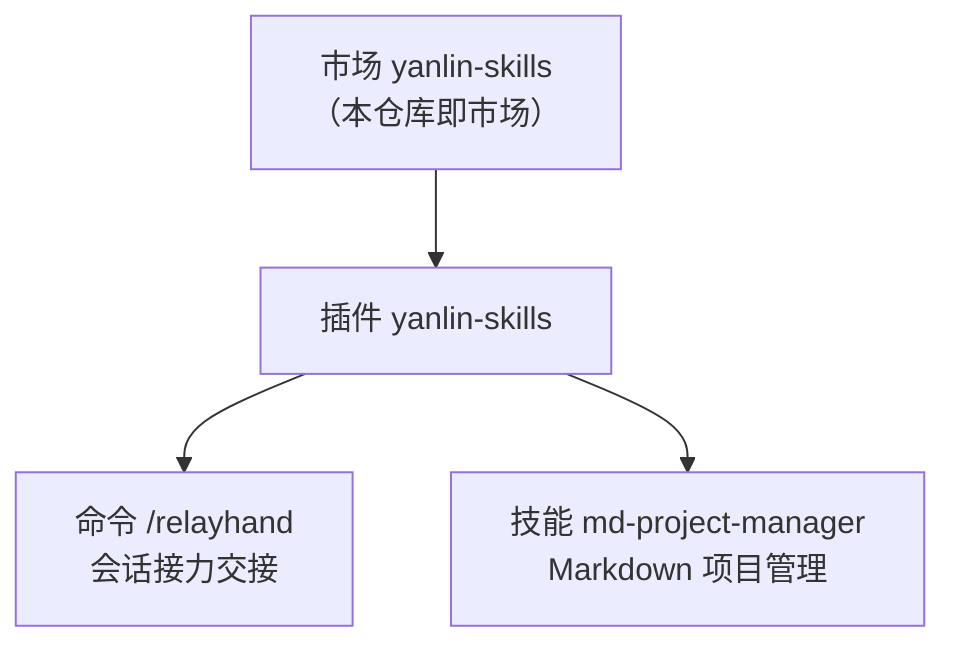

# yanlin-skills —— Claude Code 工作流合辑

[English](README.md) | **简体中文**

[](LICENSE)

Yanlin 的 Claude Code 工作流合辑——一次安装，随更新自动同步。收编个人沉淀的工作流工具：会话接力命令、Markdown 项目管理技能，后续新工具持续进同一插件。

## 安装

在 Claude Code 会话里运行两行命令：

```
/plugin marketplace add yanlin-cheng/skills
/plugin install yanlin-skills@yanlin-skills
```

装完即得：

- `/relayhand` 命令——长对话接力交接
- `md-project-manager` 技能——说"更新项目进度""创建项目文档"等即自然触发

## 合辑里有什么

### relayhand —— 会话接力命令

| | |
|---|---|
| **解决什么** | 长对话越聊越慢、原地压缩又丢细节——把对话压缩成一份面向"下一棒"的接力文档 + 可复制提示词，新对话粘贴即续 |
| **怎么触发** | 对话变长时跑 `/relayhand`；可带参数指定下一棒任务（如 `/relayhand 重构登录模块`），接力文档会围绕该任务裁剪 |
| **什么时候用** | 工作必须离开当前会话，或跨到另一个 AI 产品时 |

### md-project-manager —— Markdown 项目管理技能

| | |
|---|---|
| **解决什么** | 用纯 Markdown 管理多个项目：项目管理面板（主控文档）+ 每项目一份日志文档，AI 负责引导搭建、润色日志、同步进度 |
| **怎么触发** | 对话里说"项目管理""更新进度""记录今日工作"等自然语言即触发 |
| **什么时候用** | 个人项目管理：想要 Notion 式的总览但数据留在本地 `.md` 文件里 |

## 插件结构



单仓库、单插件、多技能：以后新增工作流工具直接进这个插件，已安装用户随更新自动获得。

## 什么时候不用

- **relayhand 不解决"压缩对话本身"**：同一个任务还在继续、只是会话变重，用 `/compact` 就够；任务做完了直接开新对话。relayhand 的主场是"把工作交出当前会话"。
- **md-project-manager 不解决"团队实时协作看板"**：它是单人文档流，没有多人编辑、实时同步、权限管理。团队协作请用 Notion / Linear 等专业工具——Notion 重度用户不必迁移。

## 其他 AI 产品用户

relayhand 提供跨产品的通用核心提示词与 Agent 自装流程：见 [yanlin-cheng/relayhand](https://github.com/yanlin-cheng/relayhand)（universal 通用提示词 + 各产品适配说明）。

## 许可与变更

- [MIT](LICENSE)
- [CHANGELOG](CHANGELOG.md)
