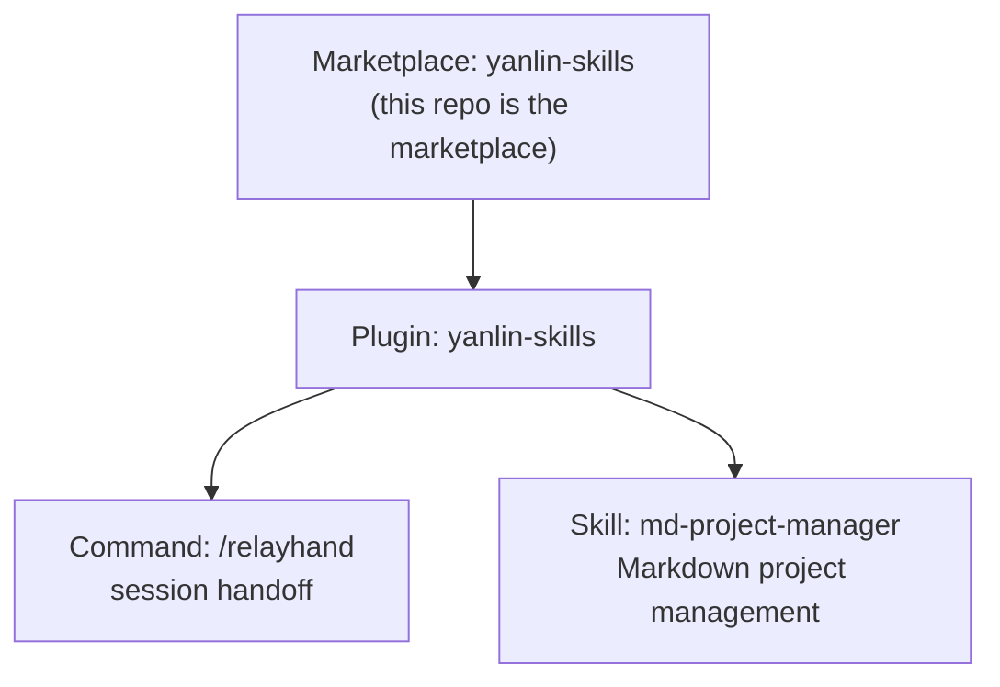

# yanlin-skills — Claude Code Workflow Collection

**English** | [简体中文](README-ZH.md)

[](LICENSE)

Yanlin's Claude Code workflow collection — install once, updates sync automatically. It bundles workflow tools distilled from daily use: a session relay command, a Markdown project management skill, with more to come in the same plugin.

> Docs are Chinese-first; this README mirrors the Chinese one section by section.

## Install

Run two commands in a Claude Code session:

```
/plugin marketplace add yanlin-cheng/skills
/plugin install yanlin-skills@yanlin-skills
```

You get:

- The `/relayhand` command — session handoff for long conversations
- The `md-project-manager` skill — triggered naturally by phrases like "update project progress" (works in Chinese; English triggers included)

## What's Inside

### relayhand — Session Relay Command

| | |
|---|---|
| **What it solves** | Long conversations get slow, and in-place compaction loses detail — relayhand compresses the conversation into a handoff note + copyable prompt aimed at the *next* session. Paste it into a fresh chat and continue |
| **How to trigger** | Run `/relayhand` when the conversation gets long; pass a task argument (e.g. `/relayhand refactor the login module`) and the note is tailored to that task |
| **When to use** | Whenever work must leave the current session — or cross to another AI product |

### md-project-manager — Markdown Project Management Skill

| | |
|---|---|
| **What it solves** | Manage multiple projects in plain Markdown: a project panel (master doc) + one log file per project. The AI guides setup, polishes log entries, and syncs progress |
| **How to trigger** | Natural-language phrases about project management, updating progress, or logging today's work (English triggers supported) |
| **When to use** | Personal project management: Notion-style overview while your data stays in local `.md` files |

## Plugin Structure



One repo, one plugin, multiple skills: new workflow tools join this plugin directly, and installed users pick them up automatically on update.

## When Not to Use

- **relayhand does not replace in-place compaction**: if the same task continues and the session merely got heavy, `/compact` is enough; if the task is done, just open a new chat. relayhand's home turf is moving work *out of* the current session.
- **md-project-manager is not a team collaboration board**: it is a single-person, file-based workflow with no multi-user editing, live sync, or permissions. For team collaboration use Notion / Linear or similar — heavy Notion users need not migrate.

## Other AI Products

relayhand ships a cross-product universal prompt with an agent-driven install flow: see [yanlin-cheng/relayhand](https://github.com/yanlin-cheng/relayhand) (universal core prompt + per-product adapters).

## License & Changelog

- [MIT](LICENSE)
- [CHANGELOG](CHANGELOG.md)
