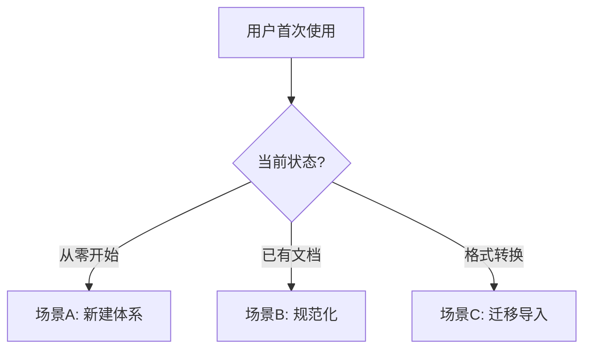

# MD 项目管理 Skill

## 概述

本 Skill 提供一套完整的 Markdown 项目管理方案，让 AI 能够：
1. 引导用户创建项目文档体系
2. 自动优化语音输入内容
3. 维护项目管理面板
4. 追踪项目进展和问题

## 核心概念

### 文档体系结构

项目管理由两类核心文档组成：

| 文档类型 | 文件名示例 | 职责 | 更新频率 |
|----------|------------|------|----------|
| **主控文档** | `项目管理面板.md` | 展示所有项目的整体进度概览 | 每日/每周 |
| **项目文档** | `项目A.md`、`项目B.md` | 记录单个项目的详细日志 | 每次有进展时 |

### 文件组织结构

#### 方案一：同一目录（推荐）

```
项目管理/
├── 项目管理面板.md          # 主控文档：所有项目的进度概览
├── 项目A.md                # 项目文档：单个项目的详细日志
├── 项目B.md
├── 项目C.md
├── 项目A.assets/           # 资源文件夹：项目相关图片、附件
└── .gitignore              # Git 忽略规则（可选）
```

#### 方案二：跨目录管理

当项目文档分散在不同目录、不同盘符、甚至不同电脑时：

```
主控文档（A项目管理.md）
    │
    ├── 链接 → 项目文档A（file:///D:/项目A/README.md）
    ├── 链接 → 项目文档B（file:///E:/项目B/README.md）
    └── 链接 → 项目文档C（https://github.com/user/repo）
```

**优点**：
1. 灵活性：项目文档可以在任何位置
2. 集中管理：主控文档统一展示所有项目
3. 可追溯：只要按日期记录，变化清晰可见

**缺点**：
1. 无法实时感知：AI 不能自动检测项目文档变化
2. 需要手动触发：用户需要告诉 AI "更新项目进度"
3. 链接维护：如果项目文档移动，需要更新链接

**使用方式**：
1. 用户说："更新项目进度"
2. AI 读取主控文档，按链接访问项目文档
3. AI 读取项目文档，提取关键信息
4. AI 更新主控文档的摘要

## 用户引导流程

当用户首次使用本 Skill 时，按以下流程引导：

### 步骤 0：快速判断用户场景

在开始引导前，先询问用户当前状态：

> **请问您现在是？**
>
> - **A. 从零开始** —— 还没有任何项目文档
> - **B. 已有文档** —— 有一些项目记录，想规范化
> - **C. 格式转换** —— 从其他工具迁移过来

根据选择跳转到对应场景：



---

### 场景 A：从零开始（详细示例）

**对话示例**：

> **用户**：我想用这个技能来管理我的项目
>
> **AI**：好的！让我帮您搭建项目管理体系。首先需要确认几个问题：
> 1. 您的工作目录在哪里？（如 `D:/Projects`）
> 2. 您目前有哪些正在进行的项目？
>
> 请告诉我，我将为您创建主控文档和第一个项目文档。

**执行步骤**：

1. **创建主控文档**：使用 [references/templates.md](references/templates.md) 中的模板 1 生成 `项目管理面板.md`
2. **创建第一个项目文档**：使用 [references/templates.md](references/templates.md) 中的模板 2 生成 `{项目名}.md`
3. **演示记录日志**：向用户展示如何写下第一条工作记录
4. **演示 AI 优化效果**：运行一次优化，让用户看到 `==高亮==` + `[^aiN]` 的效果
5. **说明日常使用方法**：告诉用户以后只需说"更新进度"或"优化日志"

**验证清单**：

- [ ] 用户能看到两个新创建的 `.md` 文件
- [ ] 主控文档中的链接能点击跳转到项目文档
- [ ] 用户理解如何记录日志和触发 AI 优化

---

### 场景 B：已有文档

如果用户已有一些项目记录，但格式不规范：

1. **扫描现有文件**：检查工作目录中已有的 `.md` 文件
2. **评估规范度**：判断是否需要按模板重新组织
3. **渐进式改造**：
   - 如果内容较少：建议使用模板重新整理
   - 如果内容较多：保留原内容，在现有基础上补充缺失部分
4. **补充主控文档**：如果缺少主控文档，帮助创建一个

---

### 场景 C：从其他工具迁移

支持从以下工具/平台迁移到本 Skill 的 Markdown 方案：

| 来源工具 | 迁移方式 | 难度 |
|----------|----------|------|
| Notion | 导出为 Markdown/HTML，清理样式代码 | 中等 |
| 飞书文档 | 导出为 Markdown 或复制文本 | 简单 |
| Trello/Jira | 导出数据，用脚本转换格式 | 较高 |
| Excel 表格 | 复制粘贴，AI 辅助转换为 Markdown | 简单 |
| 纸质笔记 | 口述给 AI，自动整理成 Markdown | 简单 |

**通用迁移步骤**：
1. 从原平台导出原始数据
2. 使用本技能的模板（见 [references/templates.md](references/templates.md)）作为目标格式
3. AI 辅助将内容映射到模板字段
4. 检查链接、图片路径是否正确

---

### 步骤 1-4：标准流程（适用于所有场景）

#### 步骤 1：确认工作目录

询问用户：
- 是否在已有项目管理文件夹中工作？
- 还是需要从零开始创建？

#### 步骤 2：创建主控文档

如果用户需要从零开始，首先创建主控文档：

```
提示用户：我将为您创建项目管理面板，这是管理所有项目的核心文档。
```

使用 [references/templates.md](references/templates.md) 中的主控文档模板（模板 1）创建 `项目管理面板.md`。

#### 步骤 3：创建第一个项目文档

引导用户创建第一个项目文档：

```
提示用户：现在让我们创建您的第一个项目文档。请告诉我项目名称，我将为您创建对应的文档。
```

使用 [references/templates.md](references/templates.md) 中的项目文档模板（模板 2）创建对应的项目文件。

#### 步骤 4：说明使用方法

向用户说明基本使用方法：
1. **记录进展**：在项目文档中使用语音或文字记录当天进展
2. **触发优化**：告诉 AI "帮我优化今天的日志"，全自动处理
3. **查看概览**：打开 `项目管理面板.md` 查看所有项目状态

## AI 行为规范

### 1. 任务指令标记（HTML 注释）

在 Typora 中不可见，AI 可通过搜索定位：

```markdown
<!-- AI: 优化以下内容 -->
<!-- AI: 转成表格 -->
<!-- AI: 分析可行性 -->
<!-- AI: 润色语言表达 -->
<!-- AI: 更新项目管理主文档 -->
```

### 2. 编辑追踪标记（高亮 + 脚注）

AI 编辑过的内容使用 `==高亮==` + `[^aiN]` 脚注组合标记，提供两种风格供选择：

#### 方式一：高亮方式（推荐 Typora 用户）

使用 Markdown 高亮语法 `==高亮==`：

```markdown
### 2026-05-06
==项目进展顺利，已完成样品设计并提交客户评审[^ai1]。==
==客户反馈整体满意，但希望在配色上做调整[^ai2]。==
原始语音记录：今天把样品给客户看了，他们说大体还行，就是颜色要改改。
```

**优点**：简洁，视觉效果好
**缺点**：需要编辑器开启高亮功能

#### 方式二：块形式（通用兼容方案）

使用引用块标记 AI 内容（适合不支持高亮的编辑器）：

```markdown
> **AI 优化内容**：这是 AI 优化后的内容[^ai1]
```

或者使用 HTML 注释标记范围：

```markdown
<!-- AI 优化开始 -->
这是 AI 优化后的内容
<!-- AI 优化结束 -->
```

**优点**：通用，所有 Markdown 编辑器都支持
**缺点**：视觉效果可能不如高亮

#### 脚注定义（统一）

无论使用哪种方式，脚注都放在文档末尾，用横线分隔：

```markdown
---
[^ai1]: AI优化于2026-05-06 09:00 | 语言润色
[^ai2]: AI优化于2026-05-06 09:00 | 补充细节
```

**脚注格式规范**：

| 字段 | 格式 | 示例 |
|------|------|------|
| 时间戳 | YYYY-MM-DD HH:MM | 2026-05-07 14:30 |
| 操作类型 | 语言润色 / 补充细节 / 结构调整 / 内容扩展 | 语言润色 |

### 3. AI 可执行任务

| 任务类型 | 描述 | 触发方式 |
|----------|------|----------|
| 语言优化 | 将口语化表达润色为规范文档语言 | 口头指令（「帮我优化日志」）或全文自动扫描 |
| 格式整理 | 统一标题层级、列表格式 | 口头指令或 `<!-- AI: 整理格式 -->` |
| 内容扩展 | 补充细节、添加示例 | 口头指令或 `<!-- AI: 扩展内容 -->` |
| 进度更新 | 将日志内容同步到主文档 | 口头指令或 `<!-- AI: 更新进度 -->` |
| 夜跑同步 | 把昨夜夜跑终态写入各项目进度条目，刷新「今晚待跑」栏 | 口头指令（「同步夜跑结果」）或晨间"更新进度"时顺带 |
| 问题分析 | 分析问题原因，提供解决方案 | 口头指令或 `<!-- AI: 分析问题 -->` |
| 方向建议 | 基于当前进展，建议下一步方向 | 口头指令或 `<!-- AI: 建议方向 -->` |

## 工作流程

### 用户日常操作

1. **记录进展**：
   - 在对应的项目文档中记录进展
   - 使用语音输入，自然表达即可（无需手动加任何标记）

2. **触发 AI 协作**：
   - 告诉 AI "帮我优化今天的日志"
   - 或 "检查一下哪些文件有变动"
   - 或 "更新项目管理面板"

3. **查阅进度**：
   - 打开 `项目管理面板.md` 查看所有项目概览
   - 点击项目链接查看详细日志

### AI 操作流程

#### 同一目录场景

1. **检测变动**：
   ```bash
   git status          # 查看新增/修改的文件
   git diff            # 查看具体修改内容
   ```

2. **优化内容**：
   - 识别口语化表达，润色为规范语言
   - 统一格式和术语
   - 保持用户原意和风格
   - 使用 `==高亮==` + `[^aiN]` 标记修改内容

3. **更新主文档**：
   - 从日志中提取关键信息
   - 更新 `项目管理面板.md` 中的项目状态
   - 同步完成度、进展摘要等

4. **提交推送**（如果使用 Git）：
   ```bash
   git add .
   git commit -m "更新项目日志：项目名称"
   git push origin master
   ```

#### 跨目录场景

当用户说"更新项目进度"时：

1. **读取主控文档**：
   - 读取 `A项目管理.md`
   - 提取所有项目链接

2. **访问项目文档**：
   - 按链接访问每个项目文档
   - 读取项目文档内容
   - 提取关键信息（进展日志、问题记录等）

3. **更新主控文档**：
   - 将提取的信息更新到主控文档
   - 更新项目状态、完成度、最新进展
   - 保持格式一致

4. **反馈给用户**：
   - 告诉用户哪些项目已更新
   - 列出关键变化

#### 夜跑结果晨间同步（night-runner 场景）

配合 cc-connect 夜跑器（总管夜间自动执行工作流）时，晨间首次同步执行以下两步：

1. **终态入条目**：把各项目昨夜夜跑终态（done/blocked/failed/unknown）写进各自进度条目或「更新日志」，附待决策文件指针（如 `<work_dir>\docs\晨报-待决策-<日期>.md`）；**只写指针不代汇总待决策内容**——细节由用户早上亲自到项目部对。终态来源以总管晨报/夜跑归档 `~/.cc-connect/night-queue-<夜归属日期>.json` 为准，机器不读面板。
2. **刷新「今晚待跑」栏**：已跑条目清除；若当晚有新排入的条目，由总管从队列摘要更新该栏（模板见 [references/templates.md](references/templates.md) 模板 1）。

## 常见问题

### Q: 我是新手，如何开始第一个项目？

A: 按以下 3 步快速上手：

1. **告诉 AI**：「我想用项目管理功能，帮我从零开始」
2. **回答两个问题**：工作目录在哪？项目叫什么名字？
3. **验证成果**：AI 会创建两个文件
   - `项目管理面板.md` —— 所有项目的总览表
   - `你的项目名.md` —— 该项目的详细日志

然后在项目文档里写下今天的工作内容，试着说一句「帮我优化日志」，看看 AI 如何用 `==高亮==` 标记修改的地方。

### Q: 如何管理多个项目？

A: 使用主控文档（项目管理面板）统一管理，每个项目单独一个文档，通过链接相互关联。新增项目时只需创建一个新的 `.md` 文件并在主控文档中注册即可。

### Q: 语音输入的内容如何优化？

A: **默认全自动，无需任何手动操作。**

你只需要：
1. 用语音/文字正常记录工作内容
2. 对 AI 说一句「帮我优化今天的日志」

AI 会自动完成以下操作：
1. 通过 `git diff` 读取你的最新变更
2. 全文扫描，自动识别口语化/不规范的表达
3. 润色为规范的文档语言
4. 用 `==高亮背景==` + `[^aiN]` 脚注标记所有修改

**进阶用法**（可选）：
如果想精确指定某一段落进行优化，可在该段落前添加 `<!-- AI: 优化语言 -->` 标记。
但大多数情况下不需要这样做，直接说「帮我优化」就够用了。

### Q: 如何追踪项目进度？

A: 在项目文档的「进展日志」部分按日期记录，每次执行自动化任务时，AI 会自动将关键信息同步到主控文档的项目概览表中。

### Q: 可以和其他工具集成吗？

A: 可以。Markdown 是最通用的格式：
- **导入 Notion/飞书**：导出为 .md 后用本 Skill 模板重新组织（参见 [references/migration-and-editors.md](references/migration-and-editors.md) 的「平台迁移指南」）
- **Git 版本管理**：初始化 Git 仓库即可实现历史追溯和多设备同步
- **其他 Markdown 工具**：Obsidian、Logseq 等均可直接打开编辑

### Q: 关闭 IDE 后自动化任务还能执行吗？

A: 取决于使用的平台：
- **CodeBuddy**：不能，会话级别，关闭 IDE 即停止
- **Qoder 远程模式**：能，任务在云端容器运行
- **TRAE**：能，但每次创建新工作空间，上下文不互通
- **Coze/OpenClaw**：能，云端执行，真正 7x24 运行

详见 [references/automation-platforms.md](references/automation-platforms.md) 第 0 节「需求引导」中的流程图，选择适合你的方案。

### Q: 如何在不同平台上使用这个技能？

A: 技能的核心逻辑（Markdown 文档优化、主控更新）是**平台无关的**。唯一需要适配的是各平台的自动化配置方式，详见 [references/automation-platforms.md](references/automation-platforms.md) 第 1 节「统一推荐提示词」，该提示词在所有平台通用。

### Q: Qoder 和 TRAE 怎么选？

A: 看你的核心诉求：
- **Qoder**：适合复杂长程任务（如完整功能开发），支持远程容器执行，本地可以关机
- **TRAE**：适合定时重复性任务（如每日日志整理），每次运行独立无状态

### Q: `==高亮==` 在我的编辑器里不生效怎么办？

A: 请对照 [references/migration-and-editors.md](references/migration-and-editors.md) 的「编辑器配置速查表」检查你的编辑器是否支持以及如何开启。如果不支持，可以使用「块形式」（引用块）来标记 AI 修改内容，效果同样清晰。

### Q: 项目多了之后文档会不会很乱？

A: 不会。主控文档提供了三层结构防止混乱：
1. **项目概览表**：一行一个项目，一目了然
2. **项目分类**：分为「进行中 / 规划中 / 已完成」三组
3. **统计信息**：自动汇总总数

建议每 2-4 周做一次归档，将已完成的项目移入「已完成」分组。

## 按需查阅（references/）

- **创建面板/项目文档时** → [references/templates.md](references/templates.md)：主控文档模板、项目文档模板、示例与模板定制指南
- **配置自动化定时任务时** → [references/automation-platforms.md](references/automation-platforms.md)：CodeBuddy/Qoder/TRAE/Coze/OpenClaw 等平台配置与选型
- **编辑器高亮不生效/从 Notion 等工具迁移/配 Git 时** → [references/migration-and-editors.md](references/migration-and-editors.md)
