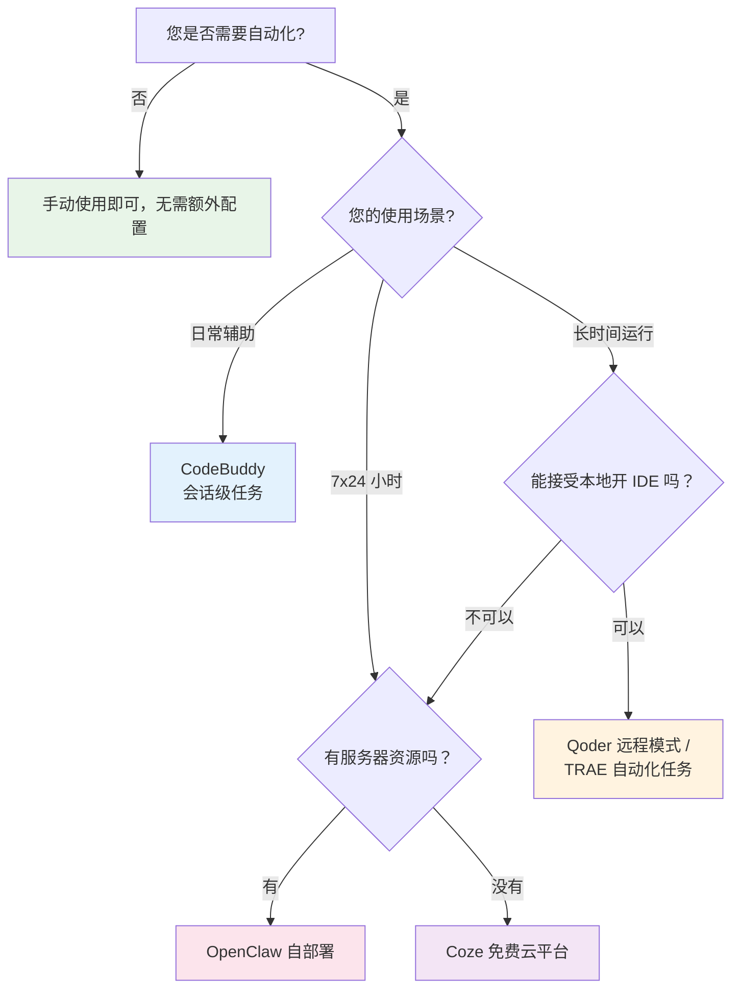

## 自动化任务流

### 概述

本技能支持与多种 AI 编辑器和平台的自动化任务功能集成，实现定时自动优化项目文档。

### 0. 需求引导

在配置自动化前，请先确认您的需求：



> **请根据上方流程图选择适合您的方案，然后跳转到对应的配置章节。**

---

### 1. 统一推荐提示词（所有平台通用）

以下提示词适用于**所有支持自动化任务的平台**，只需根据平台填入对应位置即可：

````markdown
使用 md-project-manager 技能，执行以下操作：
1. 检查 Git 变更（git status, git diff），识别最近修改的日志内容
2. 自动分析语言风格，识别口语化/不规范的表达并优化，使用 ==高亮== + [^aiN] 标记修改部分
3. 更新主控文档（项目管理面板.md）
4. 询问用户是否需要推送到 GitHub
````

**各平台填入位置一览**：

| 平台 | 提示词填入位置 |
|------|---------------|
| CodeBuddy | Agent 模式 → 自动化任务 →「提示词」字段 |
| Qoder | Quest Mode → Quest 描述框 |
| TRAE | SOLO 模式 → 自动化任务 → prompt 输入区 |
| Coze | 工作流/Agent → System Prompt 中 |
| OpenClaw | 配置文件的 agent prompt 部分 |

---

### 2. 平台能力对比

| 平台 | Agent 模式 | 定时任务 | 云端执行 | 无头运行 | 适合场景 |
|------|------------|----------|----------|----------|----------|
| **Cursor** | ✅ Agent | ❌ | ❌ | ❌ | 交互式编码辅助 |
| **Windsurf** | ✅ Cascade | ❌ | ❌ | ❌ | 交互式编码辅助 |
| **GitHub Copilot** | ✅ Agent | ❌ | ❌ | ❌ | 交互式编码辅助 |
| **CodeBuddy** | ✅ Agent | ✅ 会话级 | ❌ | ❌ | 日常辅助（IDE 开启时） |
| **Qoder** | ✅ Quest | ✅ 内置 | ✅ 远程模式 | ✅ | 长程任务、关机运行 |
| **TRAE** | ✅ SOLO | ✅ 自动化 | ❌ | ❌ | 定时重复性任务 |
| **OpenClaw** | ✅ Agent | ✅ Cron | ✅ 云端部署 | ✅ | 无人值守自动化 |
| **Coze** | ✅ 工作流 | ✅ 触发器 | ✅ 云端 | ✅ | 免费云端自动化 |

**关键发现**：
- **Cursor/Windsurf/Copilot**：专注交互式编程，无内置定时任务能力
- **CodeBuddy**：会话级定时任务，关闭 IDE 后停止
- **Qoder**：远程容器执行，本地可完全关机
- **TRAE**：每次运行创建独立工作空间，适合无状态任务
- **OpenClaw/Coze**：云端执行，可实现真正的 7x24 自动化

---

### 3. 各平台配置要点

#### CodeBuddy（日常首选）

**限制**：会话级别，关闭 IDE 后任务不执行。

**配置步骤**：
1. 进入 **Agent 模式**
2. 点击 **「添加自动化任务」**
3. 填写：
   - **名称**：如「每日项目日志优化」
   - **提示词**：粘贴上方的「统一推荐提示词」
   - **执行频率**：每天 / 按间隔 / 单次
   - **生效日期**：设置有效期

#### Qoder（长程任务）

**优势**：远程模式下本地可关机断网，任务在云端容器持续执行。

**三种执行环境**：

| 环境 | 说明 | 适用场景 |
|------|------|----------|
| 本地模式 | 直接在主工作区修改 | 快速实验、低风险任务 |
| Worktree | 后台隐藏工作区，主分支保持干净 | 并行开发、不影响主线 |
| 远程模式 | 远程容器执行，**本地可关机** | 长时间运行、资源密集型任务 |

**配置要点**：切换到 Quest 模式 → 创建 Quest → 选环境 → 填入提示词

#### TRAE（定时重复任务）

**机制**：定时执行固定提示词，每次运行创建新工作空间（无状态）。

**适用场景**：定期生成草稿、监控变化、执行固定流程

**配置要点**：SOLO 模式 → 自动化任务 → 设 Cron 频率 → 填入提示词

#### Coze（免费云平台）

**优势**：字节跳动托管，无需自己的服务器，有免费额度。

**配置要点**：创建 Bot → 工作流 → 定时触发器 → 设 Cron 表达式 → 填入提示词

#### OpenClaw（自部署）

**优势**：完全可控，开源框架，可部署在任何云服务器。

**配置要点**：编写配置文件 → 设置 cron.schedule → 部署到云服务器 → 填入提示词

---

### 4. 选择建议

| 时间维度 | 推荐方案 | 理由 |
|----------|----------|------|
| **短期（立即用）** | CodeBuddy 自动化任务 | 零成本，IDE 内即可使用 |
| **中期（1-3个月）** | Qoder 远程模式 / TRAE | 支持更长任务周期 |
| **长期（持续运行）** | Coze / OpenClaw 云端部署 | 7x24 无人值守 |

### 5. 关于"无头"自动化的现实考量

**现状**：
- 项目日志本身需要人来撰写（语音输入/文字记录）
- 完全"无人值守"的自动化不太现实——没有新日志就不需要优化
- 但可以实现**半自动化**：定时触发 AI 整理 + 人工确认推送

**推荐策略**：
1. 以 CodeBuddy 日常任务为主（人在电脑旁时自动触发）
2. 需要离线能力时升级到 Qoder 远程模式
3. 只有确实需要 7x24 运行时才考虑云端方案

